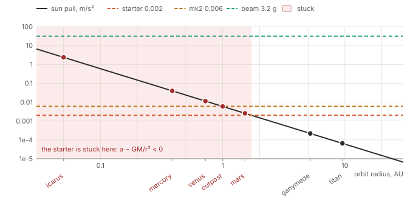
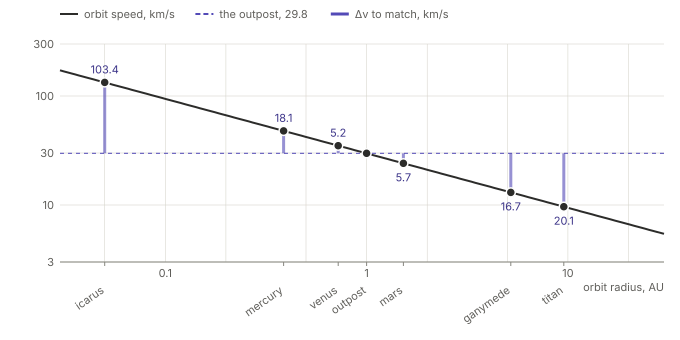
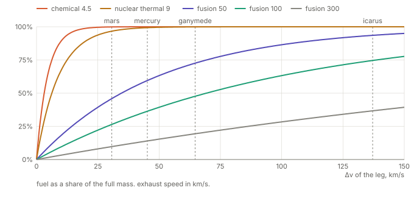

ΔV - the speed change
================================================


```sh
  # rebuild diagrams
  python3 docs/diagrams/dv.py
```

ΔV ("delta v") is a change of speed. every move in space costs ΔV: speed
up, slow down, change orbit, turn. a ship has a ΔV budget, and fuel pays
for it.

this doc holds the numbers behind [game.md](game.md)'s "ΔV mechanics",
"the gravity well" and "the flight", and behind
[phase.4.md](../backend/docs/phase.4.md) steps 4.3 and 4.6. the numbers
use `packages/domain`: `legTime()`, `SUBLIGHT` and the orbit radii in
`systems.js`. [diagrams/dv.py](diagrams/dv.py) draws the diagrams from
the formulas at the end.


GM
------------------------------------------------

- **G** is the gravitational constant, 6.674 × 10⁻¹¹ m³/(kg·s²). it is
  the same everywhere.
- **M** is the mass of the star.
- **GM** is their product, the standard gravitational parameter. for the
  sun it is 1.327 × 10²⁰ m³/s².

the formulas keep GM as one number. an orbit measures GM to about 10
digits. G alone is known to about 4.

| what            | formula   | the sun at 1 AU |
|-----------------|-----------|-----------------|
| the pull        | GM / r²   | 0.0059 m/s²     |
| the orbit speed | √(GM / r) | 29.8 km/s       |


the pull against the push - game.md's term
------------------------------------------------

game.md proposes an effective acceleration of `a - GM/r²`: the drive
pushes, and the star pulls back.



- **the starter**, 0.002 m/s², meets the pull at 1.72 AU. 5 Sol
  stations lie inside that radius: icarus, mercury, venus, mars and the
  outpost, its home port at 1.0 AU.
- **maneuver.mk2**, 0.006 m/s², meets the pull at 0.99 AU. the outpost
  is just outside.
- **the beam**, 3.2 g, meets the pull at 0.014 AU. it flies anywhere.

**the term is wrong for a ship in orbit.** it treats the ship as if it
hovers. a ship in orbit falls freely round the star, and its speed
already balances the pull. a weak drive still spirals out, slowly: ion
probes do it with 0.0001 m/s². a well does not stop a ship. it costs the
ship ΔV.


the well as ΔV - the recommendation
------------------------------------------------

a deep orbit moves fast. to dock there, a ship must match that speed. so
a leg between 2 orbits adds `|v(from) - v(to)|`. for these orbits that
is within 5% of a hohmann transfer, the classic 2-burn orbit change.



from the outpost:

| to                 | the leg today, starter | well ΔV    | well time, starter | well time, mk2 |
|--------------------|------------------------|------------|--------------------|----------------|
| icarus, 0.05 AU    | 195 days               | 103.4 km/s | 598 days           | 199 days       |
| mercury, 0.387 AU  | 157 days               | 18.1 km/s  | 105 days           | 35 days        |
| venus, 0.723 AU    | 105 days               | 5.2 km/s   | 30 days            | 10 days        |
| mars, 1.524 AU     | 145 days               | 5.7 km/s   | 33 days            | 11 days        |
| ganymede, 5.203 AU | 442 days               | 16.7 km/s  | 97 days            | 32 days        |
| titan, 9.537 AU    | 755 days               | 20.1 km/s  | 117 days           | 39 days        |

- the well time is `ΔV / a`.
- a climb out costs as much as a fall in. titan costs more than mars.
- time alone gates nothing: a slow ship still arrives. the gate is fuel.


the leg
------------------------------------------------

today's in-system leg (`legTime()`, phase 3 step 3.5) accelerates to the
midpoint, flips and brakes. `SUBLIGHT` caps the peak speed at 24 km/s.
the leg costs 2 × the peak in ΔV: once up, once down.

- a short leg never reaches the cap. its peak is `√(a·d)`.
- a long leg reaches the cap and coasts.

the starter peaks at 12.5 km/s on the way to mars, so the leg costs
25.0 km/s. the well adds 5.7, so the total is 30.7.

**most of the ΔV is the leg, not the well.** a leg at full thrust is
fast and expensive. a real mars probe flies a hohmann transfer for about
5.6 km/s, and it takes 8 months. the speed of a leg is a choice between
time and fuel. game.md's flight plan gives the player that choice: the
handles set the cruise speed.


the rocket equation - why ΔV is expensive
------------------------------------------------

```
fuel = 1 - e^(-ΔV / vₑ)        a share of the full mass
```

vₑ is the exhaust speed: how fast the drive throws its mass out.



the fuel does not grow in a line. each extra km/s costs more than the
one before, because its fuel must also push all the fuel not yet burnt.

| starter leg | ΔV         | chemical, 4.5 | nuclear thermal, 9 | fusion, 50 | fusion, 100 | fusion, 300 |
|-------------|------------|---------------|--------------------|------------|-------------|-------------|
| mars        | 30.7 km/s  | 99.9%         | 96.7%              | 45.9%      | 26.4%       | 9.7%        |
| mercury     | 45.2 km/s  | 100%          | 99.3%              | 59.5%      | 36.4%       | 14.0%       |
| ganymede    | 64.7 km/s  | 100%          | 99.9%              | 72.6%      | 47.6%       | 19.4%       |
| icarus      | 137.1 km/s | 100%          | 100%               | 93.6%      | 74.6%       | 36.7%       |

- below an exhaust speed of 10 km/s, no in-system leg is possible. this
  is game.md's "the true rocket equation breaks the setting".
- vₑ is the tuning knob of phase 4 step 4.6. at 100 to 300 km/s a player
  can plan the fuel.


the stars
------------------------------------------------

every star has its own well. M is in solar masses. every gateway sits at
1 AU.

| star             | M    | pull at 1 AU | orbit speed at 1 AU | starter meets the pull | mk2 meets the pull | the gateway, game.md's term |
|------------------|------|--------------|---------------------|------------------------|--------------------|-----------------------------|
| Sol              | 1.0  | 0.0059 m/s²  | 29.8 km/s           | 1.72 AU                | 0.99 AU            | stuck                       |
| Alpha Centauri A | 1.1  | 0.0065 m/s²  | 31.2 km/s           | 1.81 AU                | 1.04 AU            | stuck                       |
| Barnard's star   | 0.16 | 0.0010 m/s²  | 11.9 km/s           | 0.69 AU                | 0.40 AU            | flies                       |
| Wolf 359         | 0.11 | 0.0007 m/s²  | 9.9 km/s            | 0.57 AU                | 0.33 AU            | flies                       |
| Sirius A         | 2.06 | 0.0122 m/s²  | 42.7 km/s           | 2.47 AU                | 1.43 AU            | stuck                       |
| Ran              | 0.82 | 0.0049 m/s²  | 27.0 km/s           | 1.56 AU                | 0.90 AU            | stuck                       |
| Procyon A        | 1.5  | 0.0089 m/s²  | 36.5 km/s           | 2.11 AU                | 1.22 AU            | stuck                       |
| Lalande 21185    | 0.39 | 0.0023 m/s²  | 18.6 km/s           | 1.08 AU                | 0.62 AU            | stuck                       |
| Ross 154         | 0.18 | 0.0011 m/s²  | 12.6 km/s           | 0.73 AU                | 0.42 AU            | flies                       |
| Lacaille 9352    | 0.49 | 0.0029 m/s²  | 20.8 km/s           | 1.21 AU                | 0.70 AU            | stuck                       |

- under game.md's term the starter is stuck at 7 of 10 gateways.
- red dwarfs have shallow wells. a frontier system is far to reach and
  cheap to fly in.


the turn
------------------------------------------------

a turn of θ at speed v costs `ΔV = 2v · sin(θ/2)`. a reverse costs 2v.
see game.md's "the flight" for the table: in-system an escape is dear,
and interstellar it is an abort.


the formulas
------------------------------------------------

```
pull         = GM / r²
v(r)         = √(GM / r)
well ΔV      = |v(from) - v(to)|
leg ΔV       = 2 · min(√(a·d), 24 km/s)
well time    = well ΔV / a
fuel         = 1 - e^(-ΔV / vₑ)
turn ΔV      = 2v · sin(θ / 2)
meets pull   = √(GM / a)          game.md's term: stuck inside this radius

GM           = 1.32712 × 10²⁰ m³/s² × M
1 AU         = 1.496 × 10¹¹ m
```
